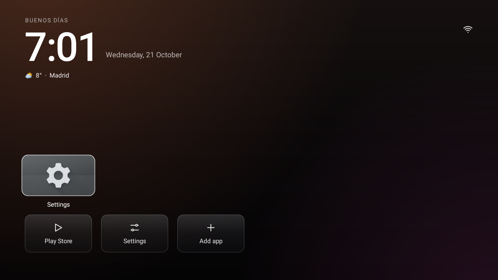
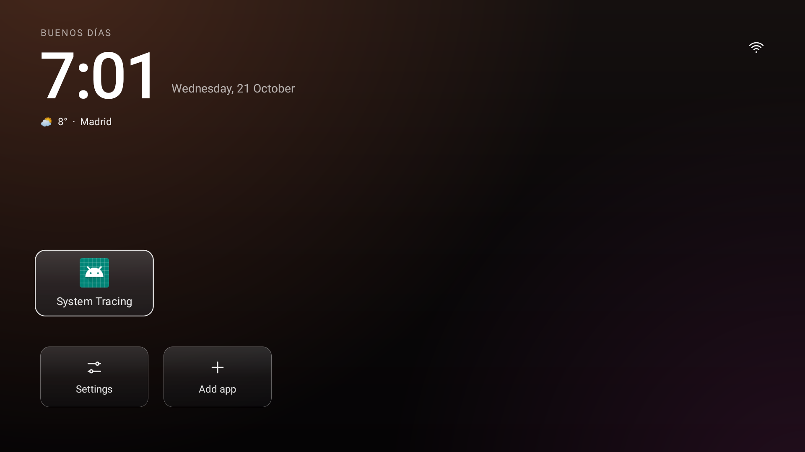

<div align="center">

# TV Detox AMG

[English](README.md) · [Español](README.es.md) · [Proyecto original](https://github.com/Ansub/tv-detox)

### Una pantalla de inicio más limpia y tranquila para Android TV.

TV Detox AMG es un fork comunitario de [TV Detox](https://github.com/Ansub/tv-detox). Conserva los controles sencillos para el mando y explora una estética inspirada en Clean Xiaomi TV.

[](https://github.com/maestrea76/TV-Detox-AMG/actions)
[](LICENSE)



</div>

## Novedades de este fork

- Superficies y estados de foco con efecto glass en las tarjetas de aplicaciones, sistema y HDMI. Se mantienen los controles del mando y las acciones sencillas del launcher.
- Reloj grande, fecha y saludo localizados, además de una línea del tiempo. Por ahora consulta Open-Meteo y muestra Madrid por defecto; todavía no hay una opción para elegir la ubicación desde la interfaz.
- Cuando Android detecta contenido multimedia activo aparece una pequeña tarjeta de reproducción. Al seleccionarla, vuelve al reproductor. Si el instalador no pudo conceder el acceso, Android puede pedir que se habilite el acceso a notificaciones.
- El estado de red sigue visible arriba a la derecha. Las aplicaciones, accesos rápidos del sistema y entradas HDMI se manejan con el mando del televisor.
- Fondos ligeros con degradados de color, sin necesidad de imágenes fotográficas.

Las capturas siguientes proceden de las pruebas automatizadas en emuladores Android TV. Las aplicaciones disponibles cambian según la imagen del emulador y el televisor real.

| Emulador Android TV · API 28 | Emulador Android TV · API 30 |
|---|---|
|  |  |

## Pruébalo

Descarga el artefacto **tvhome-apk** de una ejecución correcta de [GitHub Actions](https://github.com/maestrea76/TV-Detox-AMG/actions/workflows/build.yml). Abre la ejecución, descarga y descomprime el artefacto e instala `tvhome.apk` en el Android TV. Es una compilación de prueba de CI, no una versión publicada en Releases. Este fork firma las compilaciones con una clave distinta a la del proyecto original, por lo que Android podría pedir desinstalar una copia anterior del launcher antes de instalarlo. Desinstalarlo no revierte otros cambios de limpieza del televisor.

Para instalar desde un ordenador con Android Platform Tools:

```sh
adb connect <IP_DEL_TV>:5555
adb install -r tvhome.apk
```

Si el televisor usa depuración inalámbrica, emparéjalo y conéctalo con los puertos que aparecen en la pantalla de depuración inalámbrica. Si Android lo pregunta, selecciona TV Detox AMG como aplicación de inicio.

> **Seguridad:** los ajustes y el comportamiento varían según el fabricante. Mantén activo el salvapantallas, especialmente en televisores OLED. No desactives aplicaciones del sistema si no sabes cómo restaurarlas. Consulta la [guía del proyecto original](https://github.com/Ansub/tv-detox#help) para configurar el dispositivo, resolver problemas y deshacer cambios.

## Compilar desde el código fuente

Necesitas Java 17 y Android SDK platform 34/build-tools 34.0.0.

```sh
sh build.sh
```

El APK se genera en `out/tvhome.apk`. GitHub Actions lo compila y ejecuta pruebas smoke en emuladores Android TV (API 28 y 30). Las capturas de las pruebas están en [`docs/screenshots`](docs/screenshots/).

## Sobre este fork

TV Detox AMG es un fork independiente y no está afiliado al autor del proyecto original. Conserva la licencia MIT upstream y parte de su launcher y herramientas de limpieza. Consulta [LICENSE](LICENSE) y el [repositorio original](https://github.com/Ansub/tv-detox).
