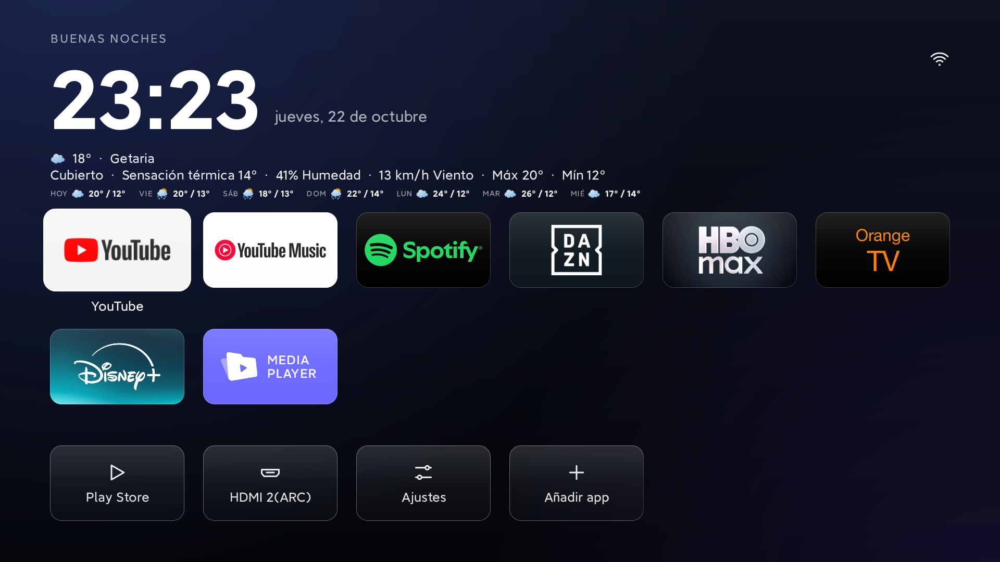
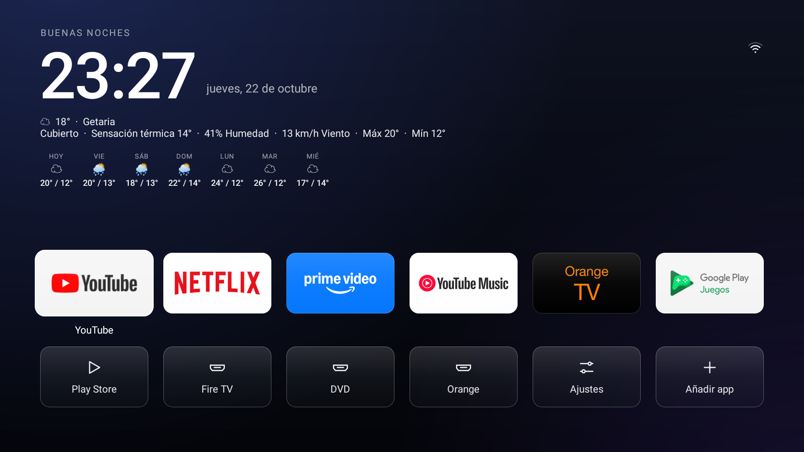
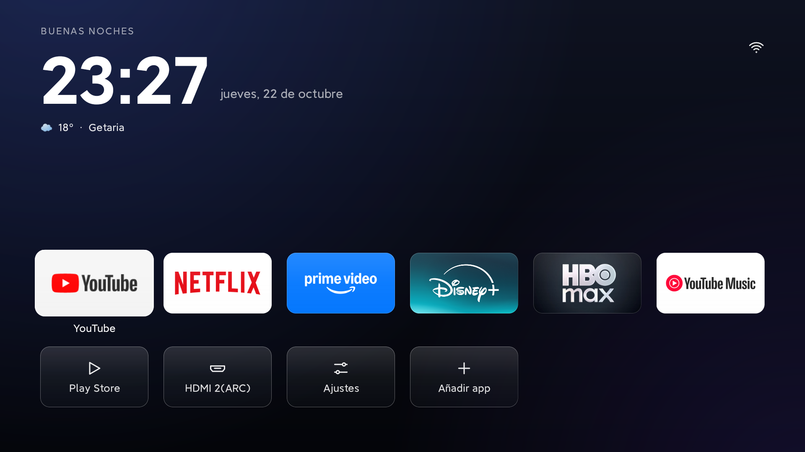

<div align="center">

# TV Detox AMG

[English](README.md) · [Español](README.es.md) · [Cambios](CHANGELOG.es.md)

### Una pantalla de inicio más limpia y tranquila para Android TV.

TV Detox AMG es un launcher independiente para Android TV. Nació del código de [TV Detox](https://github.com/Ansub/tv-detox), de Ansub Khan (MIT), y conserva sus controles sencillos para el mando mientras explora una estética inspirada en Clean Xiaomi TV. Ya no sigue las releases del proyecto original.

[](https://github.com/maestrea76/TV-Detox-AMG/actions)
[](LICENSE)



</div>

## Novedades

- Superficies y estados de foco con efecto glass en las tarjetas de aplicaciones, sistema y HDMI. Se mantienen los controles del mando y las acciones sencillas del launcher.
- Reloj grande, fecha y saludo localizados, además de una línea del tiempo de Open-Meteo. En Ajustes, Idioma cambia las etiquetas entre español e inglés; si no eliges, siguen el idioma del televisor. Tiempo tiene cuatro modos: Pequeño muestra el icono y la temperatura, Compacto añade la ciudad, Grande añade el estado del cielo, la sensación térmica, la humedad y el viento, y Extra grande añade la máxima y mínima de hoy y una fila de siete días con el cielo, la máxima y la mínima de cada día. Elegir ciudad busca una ciudad y la guarda. La búsqueda queda en la parte alta de la pantalla, así el teclado no tapa Buscar, Cancelar ni los resultados. Hasta que elijas una, la línea muestra Getaria.
- Cuando Android detecta contenido multimedia activo aparece una pequeña tarjeta de reproducción. Al seleccionarla, vuelve al reproductor. Si el instalador no pudo conceder el acceso, Android puede pedir que se habilite el acceso a notificaciones.
- El estado de red sigue visible arriba a la derecha. Las aplicaciones, accesos rápidos del sistema y entradas HDMI se manejan con el mando del televisor.
- Fondos ligeros con degradados de color, sin necesidad de imágenes fotográficas.

## Capturas

Tomadas en televisores reales con la 1.5.2.

| Sony BRAVIA (Android 9) · Extra grande | Xiaomi MiTV (Android 11) · Compacto |
|---|---|
|  |  |

El modo Extra grande añade la máxima y la mínima de hoy y la tira de siete días con el cielo, la máxima y la mínima de cada día. Con dos filas de aplicaciones, la tira pasa a una línea por día para no tocar la rejilla en pantallas de 1080p; con una sola fila mantiene el formato de tres líneas.

## Pruébalo

Descarga `tvhome.apk` de la [última release](https://github.com/maestrea76/TV-Detox-AMG/releases/latest) o el artefacto **tvhome-apk** de una ejecución correcta de [GitHub Actions](https://github.com/maestrea76/TV-Detox-AMG/actions/workflows/build.yml). Instala `tvhome.apk` en el Android TV. Las compilaciones se firman con la clave del proyecto, así que las actualizaciones se instalan encima de versiones anteriores de TV Detox AMG. Si vienes de una copia firmada con otra clave, Android podría pedir desinstalarla antes; desinstalarla no revierte otros cambios de limpieza del televisor.

Para instalar desde un ordenador con Android Platform Tools:

```sh
adb connect <IP_DEL_TV>:5555
adb install -r tvhome.apk
```

Si el televisor usa depuración inalámbrica, emparéjalo y conéctalo con los puertos que aparecen en la pantalla de depuración inalámbrica. Si Android lo pregunta, selecciona TV Detox AMG como aplicación de inicio.

> **Seguridad:** los ajustes y el comportamiento varían según el fabricante. Mantén activo el salvapantallas, especialmente en televisores OLED. No desactives aplicaciones del sistema si no sabes cómo restaurarlas. Consulta [`docs/debloat.md`](docs/debloat.md) para las reglas de limpieza y la [guía del proyecto original](https://github.com/Ansub/tv-detox#help) para configurar el dispositivo y deshacer cambios.

## Compilar desde el código fuente

Necesitas Java 17 y Android SDK platform 34/build-tools 34.0.0.

```sh
sh build.sh
```

El APK se genera en `out/tvhome.apk`. GitHub Actions lo compila y ejecuta pruebas smoke en emuladores Android TV (API 28 y 30). Esas ejecuciones también guardan sus capturas de emulador en [`docs/screenshots`](docs/screenshots/) ([API 28](docs/screenshots/smoke-api28.png), [API 28 · Extra grande](docs/screenshots/smoke-api28-xlarge.png), [API 30](docs/screenshots/smoke-api30.png), [API 30 · Extra grande](docs/screenshots/smoke-api30-xlarge.png)).

## Sobre este proyecto

TV Detox AMG es un proyecto independiente y no está afiliado al autor de TV Detox. Nació como fork de TV Detox y se distribuye con la misma licencia MIT; el aviso de copyright original se conserva en [LICENSE](LICENSE). Ya no sigue las releases del proyecto original. Consulta [CHANGELOG.es.md](CHANGELOG.es.md) para el historial de versiones.
