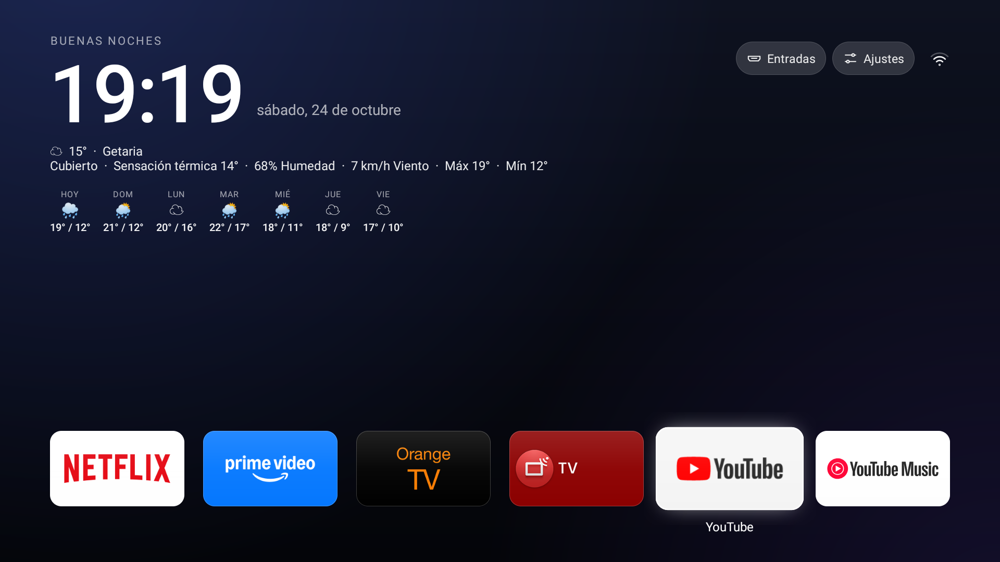
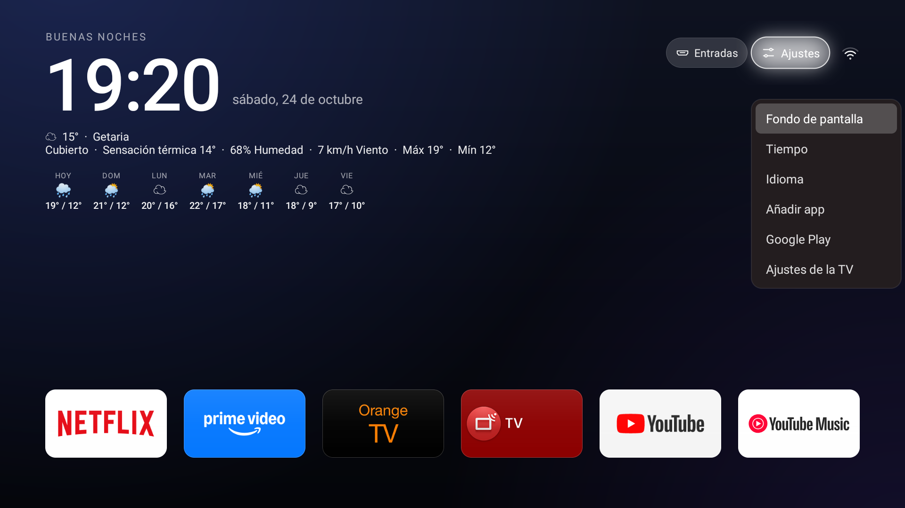
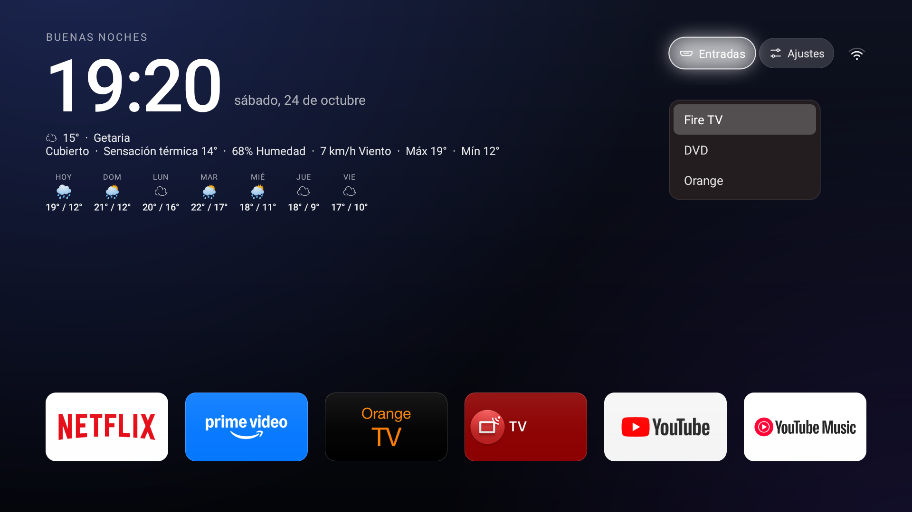

<div align="center">

# TV Detox AMG

[English](README.md) · [Español](README.es.md) · [Changelog](CHANGELOG.md)

### A calmer, cleaner home screen for Android TV.

TV Detox AMG is an independent Android TV launcher. It started from the [TV Detox](https://github.com/Ansub/tv-detox) codebase by Ansub Khan (MIT) and keeps its simple remote-first controls while exploring a Clean Xiaomi TV-inspired look. It no longer tracks the original project's releases.

[](https://github.com/maestrea76/TV-Detox-AMG/actions)
[](LICENSE)


</div>

## What’s new

- Glass-style surfaces and focus states across app, system and HDMI cards. The focused tile, icon or pill gets a soft blurred shadow, so the selection is easy to pick out.
- A large clock, localized date and greeting, plus a weather line from Open-Meteo. Settings → Language switches the home screen labels between English and Spanish; otherwise they follow the TV. Weather offers four modes: Small shows the icon and temperature, Compact adds the city, Large adds the conditions, feels-like temperature, humidity and wind, and Extra large adds today's high and low plus a seven-day strip with each day's sky, high and low. Choose location searches for a city and saves it. The search sits at the top of the screen, so the keyboard does not cover Search, Cancel or the results. Until you pick one, the line shows Getaria.
- A compact now-playing pill appears when Android reports active media. Selecting it returns to the player. Android may ask you to enable notification access if the installer could not grant it automatically.
- The clock's line carries everything else, right to left: the network icon, the **Settings** pill (Wallpaper, Weather, Language, Add app, Google Play and the TV's own settings) and, when the TV has any, the **Inputs** pill, whose menu lists every HDMI input so one pick opens it. There is no utility row under the apps, so a row of tiles goes to apps instead.
- Lightweight, color-gradient wallpapers; no photographic background assets are required.

## Screenshots

Captured on real televisions. The Sony BRAVIA runs 1.6.1; the Xiaomi MiTV shot dates from 1.5.2, before the utility row moved into the pills.

| Sony BRAVIA (Android 9) · Extra large | Sony BRAVIA · The Settings pill |
|---|---|
|  |  |

| Sony BRAVIA · The Inputs pill | Xiaomi MiTV (Android 11) · Compact |
|---|---|
|  |  |

Extra large adds today's high and low plus the seven-day strip with each day's sky, high and low. With two rows of apps the strip switches to one line per day, so it stays clear of the app grid on 1080p screens; with a single row it keeps the three-line layout.

## Try it

Download `tvhome.apk` from the [latest release](https://github.com/maestrea76/TV-Detox-AMG/releases/latest), or the **tvhome-apk** artifact from a successful [GitHub Actions run](https://github.com/maestrea76/TV-Detox-AMG/actions/workflows/build.yml). Install `tvhome.apk` on your Android TV. Builds are signed with the project's key, so updates install over previous TV Detox AMG versions. If you are coming from a copy signed with a different key, Android may ask you to uninstall it first; removing the app does not undo any separate debloating changes.

To install from a computer with Android Platform Tools:

```sh
adb connect <TV_IP>:5555
adb install -r tvhome.apk
```

If your TV uses Wireless debugging, pair and connect with the ports shown on the TV’s Wireless debugging screen. After installation, choose TV Detox AMG as the Home app if Android asks.

> **Safety:** Android TV settings and behavior vary by manufacturer. Keep the TV’s screensaver enabled, especially on OLED displays. Don’t disable system apps unless you understand how to restore them. See [`docs/debloat.md`](docs/debloat.md) for the cleanup rules and the [original project’s guide](https://github.com/Ansub/tv-detox#help) for device setup and undo instructions.

## Build from source

Requires Java 17 and Android SDK platform 34/build-tools 34.0.0.

```sh
sh build.sh
```

The APK is written to `out/tvhome.apk`. The repository’s GitHub Actions workflow builds it and runs smoke tests on Android TV emulators (API 28 and 30). Those runs also save their emulator screenshots to [`docs/screenshots`](docs/screenshots/) ([API 28](docs/screenshots/smoke-api28.png), [API 28 · Extra large](docs/screenshots/smoke-api28-xlarge.png), [API 30](docs/screenshots/smoke-api30.png), [API 30 · Extra large](docs/screenshots/smoke-api30-xlarge.png)).

## About this project

TV Detox AMG is an independent project, not affiliated with TV Detox’s author. It began as a fork of TV Detox and is distributed under the same MIT license; the original copyright notice is kept in [LICENSE](LICENSE). It no longer follows upstream releases. See [CHANGELOG.md](CHANGELOG.md) for the version history.
